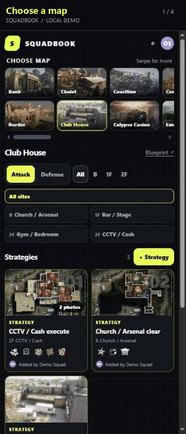
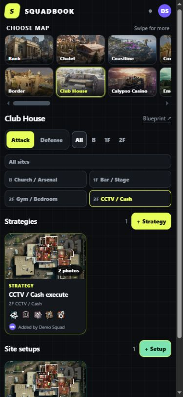
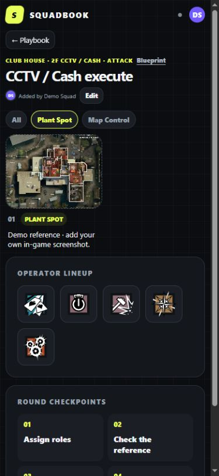
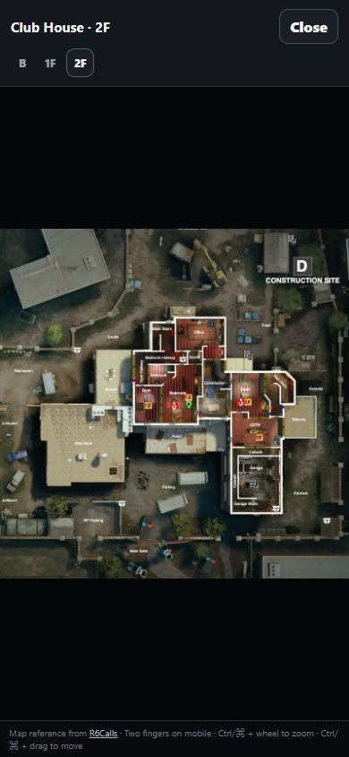
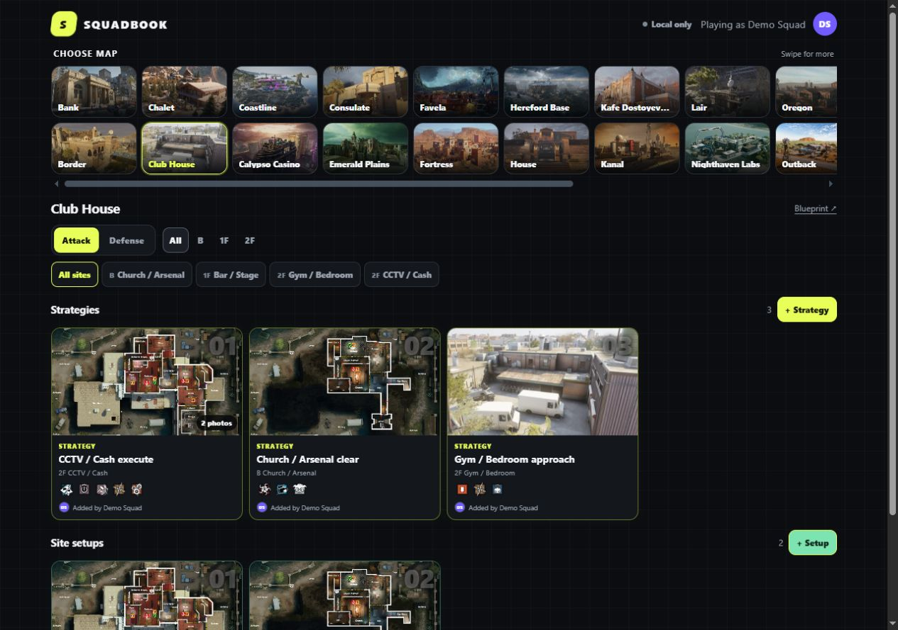

# Squadbook

A mobile-first visual strategy playbook for Rainbow Six Siege squads. Pick a map, side, and Bomb site, check the floor blueprint, then open a compact screenshot-led strategy.

**Live app:** [nuk3zz.github.io/squadbook](https://nuk3zz.github.io/squadbook/)

## See it in action

Choose a map, narrow down the Bomb site, and open a visual plan. Operator roles, short checkpoints, and an optional floor blueprint keep the reminder close at hand.

<p align="center">
  
</p>

<details>
<summary>View still screenshots — mobile and desktop</summary>

| Browse a site | Review a strategy | Open the blueprint |
| --- | --- | --- |
|  |  |  |

**On a second monitor**



</details>

*Real app captures using synthetic local demo records and bundled map references. Example plans and operator choices are illustrative; no private squad content is shown.*

## Features

- 26 squad-approved maps and their Bomb-site definitions
- Compact floor blueprints and side-specific operator icons
- Mobile pinch-to-zoom and desktop Ctrl/Command-wheel blueprint zoom
- Lightweight player profiles with no email or verification code
- Unlimited labeled screenshot-and-note references with gallery filters, file upload, or clipboard paste
- Standalone bomb-site setups for cams, drone spots, gadget placements, angles, and tricks—kept separate from full strategies
- Defense-only Power Spots grouped by title, with multiple photos and applicability to one or several bomb sites
- Creator and latest-editor profile attribution with compact avatars
- Four-digit profile recovery across browsers and devices
- Optional Supabase sharing, private media storage, and realtime refresh
- Instant repeat startup from a local snapshot while shared data refreshes in the background
- Installable iPhone/Android PWA with a standalone layout and lightweight offline shell

Squadbook uses plain HTML, CSS, and JavaScript with no build step.

**Resume or restore:** read [RESTORE.md](RESTORE.md), then the canonical [current handoff](knowledge/current-handoff.md). The private recovery repository is [nuk3zz/squadbook-private-backup](https://github.com/nuk3zz/squadbook-private-backup); its Actions are disabled. The public repository remains the production deployment source.

## Run locally

Python 3 is the only requirement to run the app. Node.js is optional for the offline verification scripts.

```bash
git clone https://github.com/nuk3zz/squadbook.git
cd squadbook
python3 -m http.server 4173 --bind 127.0.0.1 --directory dist
```

On Windows, run `powershell.exe -NoProfile -ExecutionPolicy Bypass -File .\start-local.ps1`. On Linux or macOS, run `bash ./start-local.sh`. These launchers bind to loopback. Open `http://127.0.0.1:4173` and stop with Ctrl+C.

To use another device on the same trusted local network from a Mac, run `./start-local.command` and open the address it prints. That launcher intentionally binds to the LAN. Do not expose or forward port 4173 on your router.

To verify without installing any npm packages:

```text
node scripts/check-project.mjs
node scripts/check-match-ui.mjs
node --test scripts/check-shared-store.mjs
```

## Install on iPhone

Open the live app in Safari, tap **Share**, choose **Add to Home Screen**, keep **Open as Web App** enabled, then tap **Add**. Squadbook will launch from its own icon without normal Safari controls.

## Shared squad mode

The app works locally without an account or backend. To share profiles and strategies across devices, connect a Supabase project by following [SHARED-SETUP.md](SHARED-SETUP.md).

The real `dist/data/supabase-config.json` file is intentionally ignored by Git. Only the browser-safe publishable key belongs in that file—never add a Supabase secret or service-role key.

Every push to `main` deploys the contents of `dist/` to GitHub Pages. A custom domain can be attached later.

## Data sources and credits

- Map references: [R6Calls](https://www.r6calls.com/)
- Operator references: [r6operators](https://github.com/marcopixel/r6operators)

Rainbow Six Siege and its related names and assets are property of Ubisoft. This is an unofficial fan-made squad tool and is not affiliated with Ubisoft.
